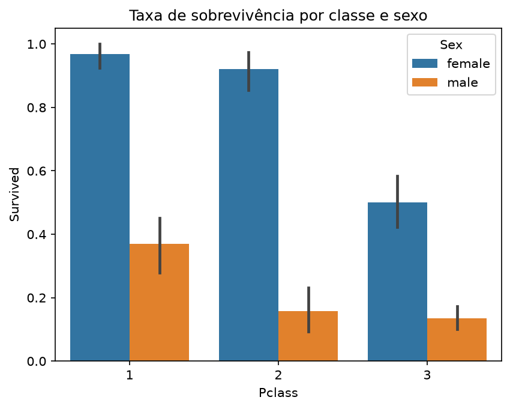
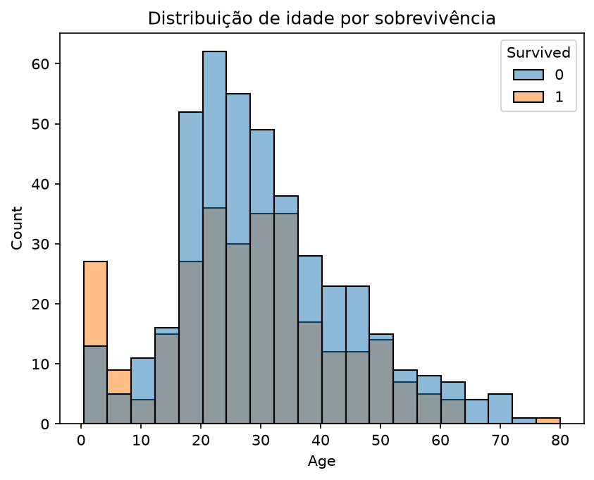
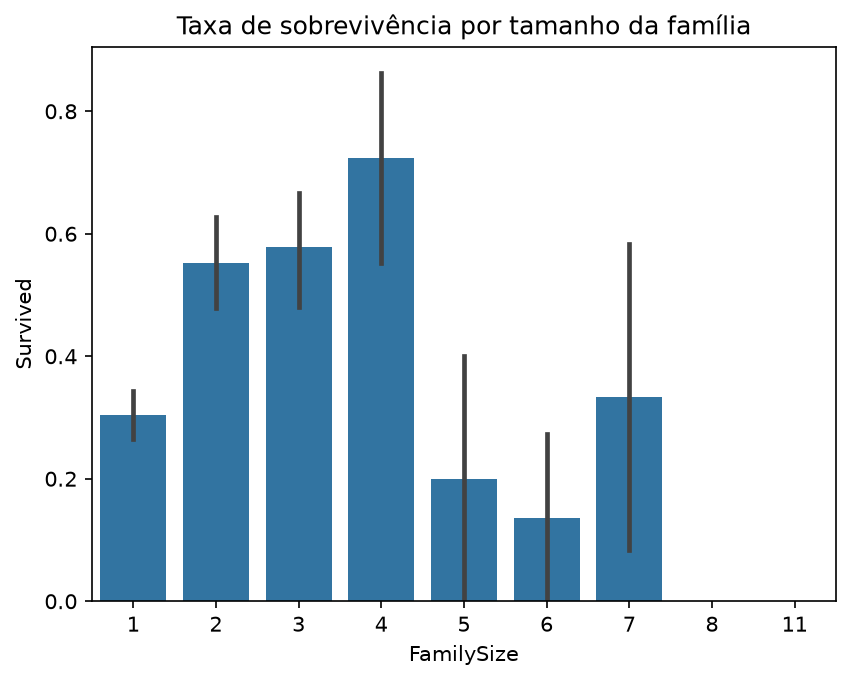
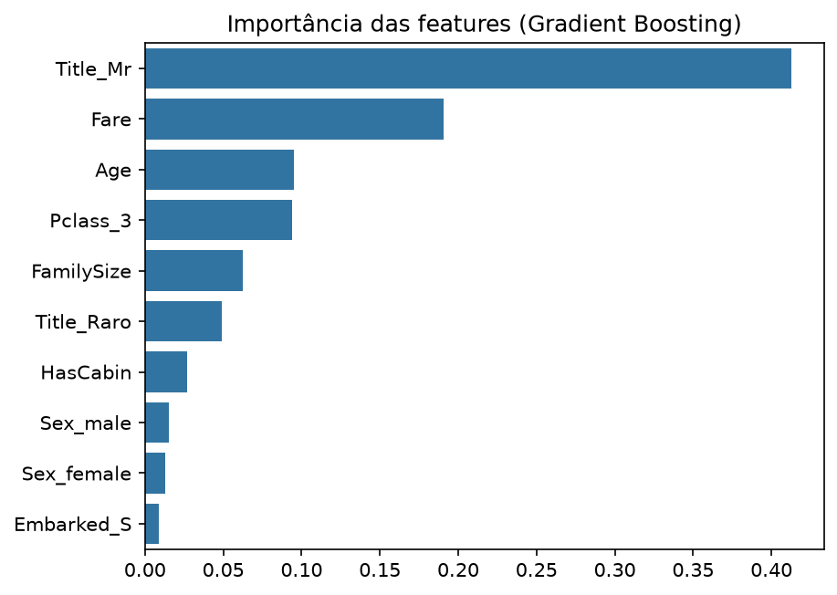

# Titanic — Ciência de Dados

Projeto de estudo baseado na competição [Titanic - Machine Learning from Disaster](https://www.kaggle.com/competitions/titanic) do Kaggle: prever quais passageiros sobreviveram ao naufrágio a partir de dados como sexo, idade, classe e família.

**Melhor resultado:** 0,77751 de acurácia no Kaggle com um Random Forest, contra 0,76555 da regra simples "toda mulher sobrevive".

## Principais descobertas

**Sexo e classe decidiram quase tudo.** 74% das mulheres sobreviveram, contra 19% dos homens. Uma mulher da 3ª classe (50%) teve mais chance que um homem da 1ª (37%).



**Crianças pequenas foram priorizadas.** Cerca de 70% das crianças de até 5 anos sobreviveram, bem acima da média geral de 38%.



**Viajar sozinho ou em família grande era pior.** Famílias de 2 a 4 pessoas sobreviveram mais que quem estava sozinho ou em grupos de 5 ou mais.



## Modelos

Todos os modelos usam o mesmo `Pipeline` do scikit-learn: valores faltantes preenchidos com estatísticas do treino, *one-hot encoding* das categorias e as features criadas em [`src/features.py`](src/features.py) (título extraído do nome, tamanho da família, viajar sozinho, ter cabine registrada).

| Modelo | Validação cruzada (5 partes) | Kaggle |
| --- | --- | --- |
| Baseline "mulher sobrevive" | 78,7% | 0,76555 |
| Gradient Boosting ajustado | 84,5% | 0,76315 |
| Regressão Logística | 83,6% | 0,76794 |
| Random Forest ajustado | 83,9% | 0,77033 |
| **Random Forest raso** (`max_depth=5`) | 83,2% | **0,77751** |



O título `Mr` (homem adulto) foi a feature mais importante, porque junta sexo e idade numa informação só.

## Aprendizados

- **Validação cruzada alta não garante boa nota.** O Gradient Boosting teve a melhor validação (84,5%) e a pior nota no Kaggle, abaixo até da baseline: *overfitting*. Um modelo mais simples generalizou melhor.
- **Com poucos dados (891 passageiros), a validação é otimista.** A nota no Kaggle ficou de 6 a 8 pontos abaixo, e diferenças de 1 ponto entre modelos estão dentro do ruído.
- **Criar features vale mais que trocar de modelo.** Extrair o título do nome trouxe a informação mais útil do projeto.
- **Transformações precisam ser aprendidas só com o treino.** Colocar o pré-processamento dentro de um `Pipeline` evita vazamento de dados na validação.

## Estrutura

```
notebooks/
├── 01_exploracao.ipynb          # pandas e gráficos: quem sobreviveu?
├── 02_baseline.ipynb            # regra "mulher sobrevive" e primeira submissão
├── 03_limpeza_e_features.ipynb  # valores faltantes e criação de features
└── 04_modelagem.ipynb           # comparação de modelos, ajuste e submissões
src/features.py                  # engenharia de features reutilizável
reports/figures/                 # gráficos usados neste README
submissions/                     # arquivos enviados ao Kaggle
```

## Como reproduzir

Requisitos: Python 3.12+, [uv](https://docs.astral.sh/uv/) e uma conta no Kaggle com o [token da API](https://www.kaggle.com/settings) configurado.

```bash
git clone https://github.com/emanuelpintosampaio/titanic-ciencia-de-dados.git
cd titanic-ciencia-de-dados
uv sync

# Os dados não ficam no repositório (regras do Kaggle)
uv run kaggle competitions download -c titanic -p data
unzip data/titanic.zip -d data

uv run jupyter lab
```

Depois, rode os notebooks em ordem.

## Tecnologias

Python, pandas, matplotlib, seaborn, scikit-learn e JupyterLab.
